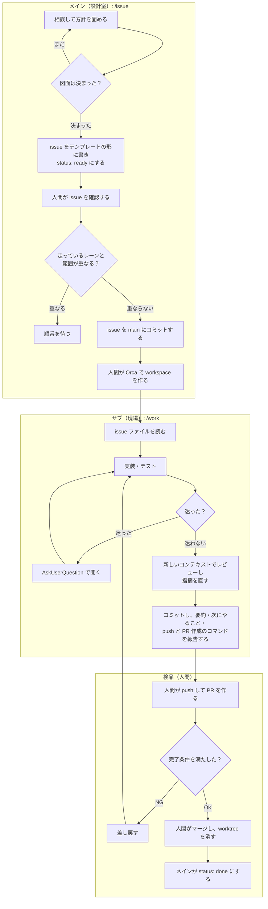

# 並行開発の進め方（人間用）

issue ファイルを作業指示書にして、Claude を2役に分けて並行で進める。**この文書は人間が手順を思い出すためのもの。**Claude が何をするかの詳細は skill にある。

| 役 | どこで | Claude に打つもの | 中身 |
| ---- | ---- | ---- | ---- |
| メイン（設計室） | main のセッション | `/issue <issue名>` | [issue スキル](../.claude/skills/issue/SKILL.md) |
| サブ（現場） | Orca の workspace（worktree） | `/work <issue名>` | [work スキル](../.claude/skills/work/SKILL.md) |
| 人間（検品） | ターミナル・GitHub・Orca | — | この文書 |

## 全体の流れ



CI や PR の自動レビューを組み込むときは P と M の間に入れる。

## 人間がやること

### 1. 何を並べるか決める（main のセッション）

- [guide-roadmap.md](guide-roadmap.md) の「順序と並行できる組」で、今走らせてよい issue を確かめる
- 触るディレクトリが重なる issue は同時に走らせない。迷ったらメインに「これと並べて大丈夫？」と聞く

### 2. issue を ready にする（main のセッション）

```
/issue <issue名> ready
```

1. メインの質問に答えて方針を決める
2. 書き直された issue を読む。特に「範囲」「完了条件」「迷ったら」
3. よければ「コミットして」と伝える
4. ターミナルで main を push する（`git push origin main`）

### 3. workspace を作る（Orca）

- ブランチ名は `feat/<issue名>`、元は main
- 初回は workspace のターミナルで `pnpm install`

### 4. サブに渡す（workspace のセッション）

```
/work <issue名>
```

- サブからの質問（AskUserQuestion）に答える。範囲の外を触りたいと言われたら、その場で許すか、メインで issue を直すかを決める
- issue を直したときは、main でコミットしてから workspace のターミナルで `git merge main` を打ち、サブに「issue を読み直して」と伝える

### 5. push して PR を作る（ターミナル）

サブの報告の最後にあるコマンドを、**1行ずつ**打つ。

```
git push -u origin feat/<issue名>
gh pr create --base main --title "..." --body-file ...
```

push のときに husky が `pnpm check` を走らせる。落ちたらサブに出力を渡して直させる。

### 6. 検品する（GitHub）

- issue の「完了条件」を1つずつ、PR とサブの報告の証拠で確かめる
- NG なら、同じ workspace のサブに指摘を渡して直させ、5 に戻る（PR は push すれば更新される）

### 7. マージして片付ける

1. GitHub でマージする
2. Orca で workspace（worktree）を消す
3. main のターミナルで `git pull`
4. main のセッションで `/issue <issue名> done` → 「コミットして」→ `git push origin main`

## 困ったとき

| 状況 | どうするか |
| ---- | ---- |
| `pnpm-lock.yaml` が衝突した | 手で直さない。後からマージする側で `pnpm install` して作り直す |
| サブが同じ確認で3回失敗して止まった | 推測で続けさせない。報告をメインに持っていき、issue を直すか分割する |
| 実装中に前提（ルール・契約・spec）を変えたくなった | main で直してコミットし、workspace で `git merge main` |
| サブが issue ファイルを書き換えた | 差分から戻させる。直したい内容はメインに伝える |

## 直したいときにどこを直すか

| 直したいこと | 直す場所 |
| ---- | ---- |
| 人間の手順、流れの図 | この文書 |
| メインの手順、issue の形・`status`・テンプレート | [issue スキル](../.claude/skills/issue/SKILL.md) |
| サブの手順、報告の形 | [work スキル](../.claude/skills/work/SKILL.md) |
| 衝突しやすいファイル、確認・レビュー・PR の手段 | [issues/README.md](../issues/README.md) |
| コミットの形式・scope | `.claude/rules/rule-git.md` |
| 順序、並行できるレーン | [guide-roadmap.md](guide-roadmap.md) |
