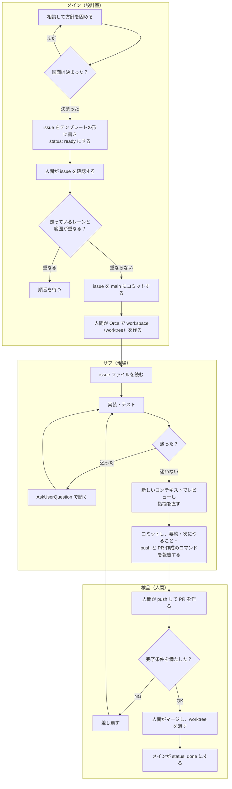

# issues

思いつき・未決事項と、並行開発の作業指示書を置く。**1 issue = 1 ファイル**。どちらの段階にあるかは frontmatter の `status` で表す。

- 書くのはメイン（設計室）だけ。サブ（現場）は読むだけで、結果は報告で返す
- ファイル名は `<kebab-case の要約>.md`。番号は振らない。spec を作る issue は spec 名にそろえる（例: `schedule-blocking.md`）
- issue 同士はファイルへのリンクで参照する（例: `[schedule-blocking](schedule-blocking.md)`）
- `#12` のような番号は GitHub の issue・PR を指す。閉じた issue は [GitHub](https://github.com/yoshipon-tech/site-blocker/issues?q=is%3Aissue) に履歴として残している。ここに移した issue は、GitHub 側を閉じたときのコメントで移した先のファイルを案内している
- spec（`docs/specs/`）がある機能は、issue から spec を参照する。issue に設計を書き写さない

## frontmatter

```yaml
---
status: backlog
labels: [spec]
---
```

| `status` | 意味 | サブに渡すか |
| ---- | ---- | ---- |
| `backlog` | 思いつき・未決。書き方は自由 | 渡さない |
| `ready` | 方針が固まり、下の「issue テンプレート」の形に書き直した作業指示書。1つの workspace（worktree）で完結する | 渡せる |
| `done` | マージ済み。ファイルは消さずに残す | — |

- `backlog` → `ready` は、メインが相談して方針を固め、テンプレートの形に書き直すときに変える
- `ready` → `done` は、人間がマージしたあとにメインが変える
- `labels` は `spec`（spec を作る単位）と `question`（決めることがある）。どちらでもなければ `[]`
- 議論の経緯は本文の末尾の「経緯」に日付つきで足す

## 運用フロー



CI はまだ入れていない。Claude の PR レビューは、PR に `@claude` と書けば動く（`.github/workflows/claude.yml`）が、このフローには組み込んでいない。どちらも組み込むなら P と M の間に入る。

順序と、いま並行できる組は [docs/guide-roadmap.md](../docs/guide-roadmap.md) を見る。

## 範囲が重なるかの判断

「範囲」は issue の「触ってよいファイル」で判断する。次のファイルはどのレーンからも触られやすいので、**同時に走らせる issue のうち1つだけに許可する**か、触らないものに入れる。

| ファイル | 重なり方 |
| ---- | ---- |
| `pnpm-lock.yaml` | ルートに1つだけ。どちらかのアプリで依存を足すと書き換わる |
| ルートの `package.json`・設定ファイル | 共通スクリプトや lint 設定 |
| `.claude/rules/`・`docs/guide-*.md`・`README.md` | 前提の更新。main で先に確定させる |

依存の追加が要る issue は、ほかのレーンと同時に走らせない。どうしても並べるなら、後からマージする側が `pnpm install` でロックファイルを作り直す（手で直さない）。

## issue テンプレート

`status: ready` にするときの形。

```markdown
---
status: ready
labels: []
---

# <要約>

## 目的

なぜやるか。終わると何ができるようになるか。

## 範囲

- 触ってよいファイル:
- 触らないもの:

## 完了条件

- [ ] 

## 確認方法

実際に走らせるコマンド・テスト・ブラウザでの確認内容。

## 迷ったら

ここに書いてあることは自分で決めず、AskUserQuestion で聞く。
確認して報告すればよいもの（調べた結果を返すだけのもの）もここに書く。

## 終わる前に

新しいコンテキストでレビューし（`review` スキルをサブエージェントで呼ぶ）、
`rule-review.md` の `MUST` を直してからコミットする。

## 終わったら

報告の最後に次を書く。

- 要約（何を変えたか、迷って聞いたこと、確認して分かったこと）
- 次にやること
- push と PR 作成のコマンド。人間がターミナルで1つずつ実行するので、`&&` でつながず別の行に書く
  `git push -u origin <ブランチ>`
  `gh pr create --base main --title "<タイトル>" --body-file <本文ファイルの絶対パス>`
  本文は `.github/pull_request_template.md` の項目で書き、ファイルに置く
```
